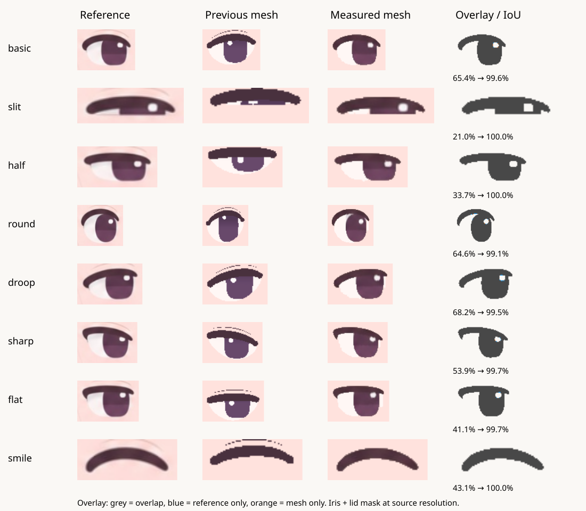

# 캐릭터 눈 구조

기존 눈매는 얼굴 GLB에 들어 있는 흰자·홍채, 윗눈꺼풀, 아래 테두리, 주름 등의 메시를 눈매 ID별로 교체한다. 두상과 눈썹은 독립 파츠다. 스튜디오와 게임은 얼굴 편집값으로 파츠를 변형하고 남녀 체형별 얼굴 스케일과 오프셋을 적용한 뒤 머리 본에 붙인다.

새 세트는 첨부된 1212×878 이미지에서 눈 8종의 실제 윤곽과 색을 추출한다. 각 열마다 윗선·아랫선·흰자 경계와 세로 색 샘플 33개를 기록한다. 이를 기존 눈의 위치와 가로 폭에 맞춰 메시로 만들고, 깊이는 기존 얼굴의 앞쪽 삼각형에서 구한다. 홍채 색 선택은 홍채 영역에만 적용한다. 웃는 눈은 닫힌 윗선으로 표현한다.

| 눈매 | 구분 기준 |
| --- | --- |
| 기본형 | 완만한 윗곡선과 열린 흰자 |
| 실눈 | 홍채가 조금 드러나는 얕은 틈 |
| 반실눈 | 낮은 윗눈꺼풀과 실눈보다 열린 아래쪽 흰자 |
| 둥근눈 | 높은 윗곡선과 넓은 눈 뜨임 |
| 처진눈 | 바깥 눈꼬리가 낮은 윤곽 |
| 날카로운눈 | 바깥 눈꼬리가 높은 윤곽 |
| 무표정형 | 낮고 평평한 윗선과 안정적인 눈꼬리 |
| 웃는눈 | 위로 올라간 닫힌 곡선 |

열린 눈매에는 안쪽 절반에 짧고 옅은 윗눈꺼풀 주름 메시를 좌우 대칭으로 추가한다. 피부 팔레트에 맞춘 코·주름의 잉크 강도는 각각 45%와 32%이며, 코 파츠는 기존 세로 길이의 65%로 축소한다. 닫힌 눈매에는 새 주름을 추가하지 않는다.

새 눈매는 캐릭터 스튜디오와 게임 런타임의 기본 눈매다. 기존 눈매 ID를 읽으면 유사한 `reference-*` ID로 정규화하며, 저장 초기화 없이 적용한다. NPC는 기존 시드와 난수 호출 순서를 유지하며 신형 열린 눈매만 사용한다. 구형 메시는 닫힌 눈 윤곽 생성과 비교용으로 보존한다. 눈매 교체는 두상 정점, 눈썹 선택값, 피부 재질을 건드리지 않는다.

## 사진과 정면 메시 비교

사진에서 눈 하나를 잘라낸 뒤 모델의 실제 눈 메시를 같은 폭과 눈높이로 정렬했다. 모델의 앞면 삼각형을 소프트웨어로 래스터화하고 원본 해상도에서 픽셀별로 비교했다. 좌우 눈은 같은 데이터를 대칭 배치한다.

겹침률은 윗눈꺼풀과 홍채의 짙은 영역에 대한 IoU다. 사진과 렌더 모두 같은 RGB 임계값(R<160, G<112, B<155)을 적용했다. 흰자, 피부, 눈썹, 주름, 색상 전체의 일치율은 포함하지 않는다. 표의 100%는 이진 마스크가 같다는 뜻이다.

| 눈매 | 직전 메시 IoU | 측정 메시 IoU |
| --- | --- | --- |
| 기본형 | 65.4% | 99.6% |
| 실눈 | 21.0% | 100.0% |
| 반실눈 | 33.7% | 100.0% |
| 둥근눈 | 64.6% | 99.1% |
| 처진눈 | 68.2% | 99.5% |
| 날카로운눈 | 53.9% | 99.7% |
| 무표정형 | 41.1% | 99.7% |
| 웃는눈 | 43.1% | 100.0% |

윤곽은 약 62~68픽셀 폭의 원본 눈에서 추출하므로 확대하면 원본 샘플 간격이 보일 수 있다. 얼굴에 적용한 정면·45도 소프트웨어 렌더와 두상 보존·앞면 방향·홍채 색상 분리 테스트를 확인했다. 브라우저 WebGL의 실제 조명, 화면 안티앨리어싱, 모바일 표시 결과는 이 비교의 검증 범위 밖이다.
